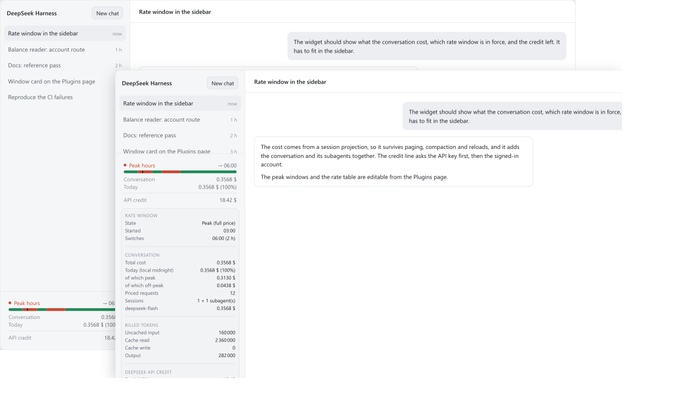

# dsh-deepseek-credit

[](https://github.com/xanareld/dsh-deepseek-credit/actions/workflows/verify.yml)

## Description

The DeepSeek cost and credit plugin for [DeepSeek Harness](https://github.com/deepseek-ai)
(DSH): what a conversation cost, which rate window is in force, and how much API credit is
left — in the sidebar where you already look.

<p>
  
</p>

_The interface is a reproduction, not a screenshot of a running installation: the widget's
markup and stylesheet are the plugin's own, while the surrounding shell and the figures are
illustrative._

The package, [`dsh-deepseek-credit`](dsh-deepseek-credit/), adds the peak/off-peak rate
window, the exact cost of a conversation with its subagents, the remaining API credit, a
`tariff_credit` tool an agent can call for its own spend, and a configuration card on the
Plugins page. Version 0.1.0, verified against DSH `0.2.0-rc.2`; `pnpm verify` covers it
with 198 test cases on Linux and Windows.

The cost is a **session projection** rather than something the page counts: it survives
paging, compaction and reloads, and it adds a conversation and its subagents together. The
credit line asks the API key first and the signed-in DeepSeek account second. Both routes,
DeepSeek's billing rule, and every endpoint involved are recorded with their source in
[docs/reference.md](docs/reference.md).

## Install

From the DSH **Plugins** page, add the package directory; or install it into a profile as
a dependency:

```sh
cd "$DSH_HOME/profiles/<profile>" && pnpm add /path/to/dsh-deepseek-credit
```

Restart DeepSeek Harness: the widget appears at the foot of the sidebar. The package's own
[README](dsh-deepseek-credit/README.md) shows what it displays and how to read it.

## Configure

Nothing is mandatory, and two places set the same keys.

**In the application** — **Plugins** → this plugin's row → the configuration card: balance
base, credential reference, timeouts, refresh cadence, the diagnostics note, the peak
windows, the Chinese holidays, weekends, and the rate table. A field stages what is typed,
writes one operation per **Save**, and says so when the Host refuses a value.

**In the profile** — its `cordis.patch.yml`, which is what a deployment, a script or a
versioned configuration should use:

```yaml
- id: tariff-credit
  config:
    apiKeyRef: DEEPSEEK_API_KEY
    schedule:
      holidays: ['2026-10-06']
    rates:
      deepseek-flash: { cacheRead: 0.006, cacheMiss: 0.3, output: 1.2 }
    refreshMs: 60000
```

Every key, its type, default and accepted range, and the precedence between the two places
are in [docs/configuration.md](docs/configuration.md). A malformed value falls back to the
shipped default and is reported in the widget's detail rather than ignored in silence.

## Develop

```sh
pnpm install
pnpm verify      # eslint + prettier --check + node --test + metrics
```

`pnpm verify` is the one command that decides whether a change is acceptable, and
[.github/workflows/verify.yml](.github/workflows/verify.yml) runs it on Linux and Windows.
Thresholds are declared once in [eslint.config.js](eslint.config.js), set at the level of
the code that exists, and then ratcheted down.

Packages sit at the repository root, because a DSH profile links those exact paths, and
the documentation lives in [`docs/`](docs/), never inside a package:
[docs/architecture.md](docs/architecture.md) for the design and its reasons, and
[docs/reference.md](docs/reference.md) for every external fact with its source. The suite
runs without a network, a browser or the harness runtime.

## Licence

MIT — see [LICENSE](LICENSE). Copyright (c) 2026 xanareld.
